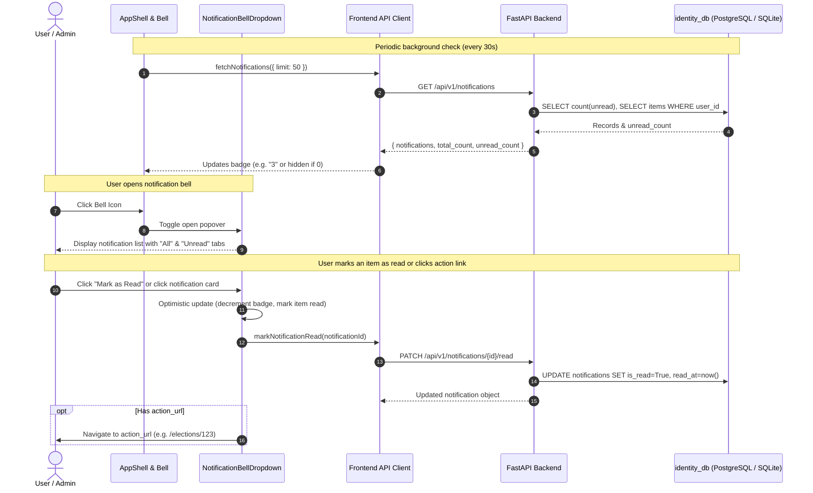

# Pollwise — Functional Notification Bell Design Document

**Document type:** System Design Specification  
**System:** Pollwise Institutional Voting Platform  
**Scope:** Functional notification bell, real-time unread counter, notification popover dropdown, notification lifecycle events, and API/data architecture  
**Target File:** `docs/superpowers/specs/2026-11-04-functional-notification-bell-design.md`  
**Date:** 2026-11-04  

---

## 1. Intent and Why

In Pollwise, the top navigation bar in `AppShell.tsx` features a notification bell icon with a static badge displaying `3`. Currently, this bell is purely cosmetic markup: clicking it does nothing, the badge number is hardcoded, and there is no underlying database model or API to deliver user notifications.

Users (both personal account voters and institutional election administrators) require timely awareness of important electoral events:
1. **Personal Account Voters:** Need to know when they are registered for an election, when voting opens, when their ballot is successfully received and confirmed, and when final certified election results are published.
2. **Institutional Administrators & Election Managers:** Need alerts when an election transitions states (e.g. Draft -> Active -> Tallying -> Certified), when voter rosters or CSV imports finish processing, and when official certified audit reports are generated and ready for download.

Transforming the notification bell into a dynamic, functional notification center enhances platform trust, responsiveness, and situational awareness while adhering to Pollwise's privacy and security protocols.

---

## 2. Goals, Non-Goals, and Anti-Goals

### Goals
- Replace the static bell icon and hardcoded badge in `AppShell.tsx` with a dynamic, interactive `NotificationBellDropdown` component.
- Display an accurate unread counter badge that dynamically increments when new alerts arrive and decrements as items are read.
- Provide a slideover/popover panel on bell click featuring:
  - Header with unread count and a "Mark all as read" button.
  - Filter tabs: "All" and "Unread".
  - Chronological list of user notifications with relative timestamps ("2m ago", "1h ago", "Yesterday").
  - Type-specific visual icons and category tags (e.g., `election_status`, `voting`, `report_certified`, `eligibility`, `system`).
  - Read/unread indicators (visual dot, background highlight).
  - Quick-action buttons / deep links directing the user to the relevant page (e.g., `/elections/{id}`, `/results/{id}`, `/dashboard`).
  - Single-click "Mark as read" toggle without leaving the popover.
  - Polished empty states ("All caught up!" / "No notifications yet").
  - Click-outside and keyboard `Escape` dismissal.
- Implement a dedicated `notifications` table in `identity_db` associated with `users.id`.
- Build FastAPI REST endpoints for retrieving notifications, marking single notifications read, and marking all read.
- Provide automated event helper hooks in backend services to emit notifications when key lifecycle events occur (e.g., election activated, report generated, onboarding completed).
- Use TanStack Query on the frontend with background refetching (every 30 seconds) and optimistic cache updates for instant UI feedback.

### Non-Goals
- External push notifications (SMS, web push push-workers, or mobile OS APNs) in this phase.
- Persistent user settings for mute/frequency controls (can be added in a future settings iteration).
- Anonymous voter roll notification tracking (voters participating via temporary anonymous slips without accounts receive their on-screen receipt; notifications belong to authenticated Pollwise user accounts).

### Anti-Goals
- **No Fabricated Mock Counters:** Do not hardcode numbers or fabricate fake counts. When count is 0, the badge is hidden.
- **No Intrusive Modals:** Notifications must not block the screen or hijack user workflows; they must live inside the non-blocking top bar popover.
- **No Secret Ballot Leakage:** Notifications must never disclose *how* a voter voted or associate candidate choices with user records. A ballot confirmation notification only confirms receipt code and timestamp.

---

## 3. Approaches Considered

### Approach 1: WebSocket / Server-Sent Events (SSE) Real-Time Stream
* **Overview:** Establish a persistent WebSocket or SSE connection per logged-in client to stream notification payloads instantly from backend pub/sub.
* **Tradeoffs:**
  * *Pros:* Millisecond-latency real-time updates.
  * *Cons:* Substantially higher operational complexity, stateful server connection management, issues with connection timeouts, proxies, and test harness fragility.

### Approach 2: REST Endpoints with React Query Background Polling (Selected)
* **Overview:** Build REST endpoints (`GET /api/v1/notifications`, `PATCH /api/v1/notifications/{id}/read`, `POST /api/v1/notifications/mark-all-read`) backed by SQLAlchemy in `identity_db`. Frontend queries via `@tanstack/react-query` with a 30-second refetch interval and instant optimistic cache mutations.
* **Tradeoffs:**
  * *Pros:* Simple, robust, stateless, highly reliable across all environments (dev, test, production). Fast optimistic UI updates guarantee zero perceived latency for user actions.
  * *Cons:* Background updates have up to a 30-second delay when new external events occur, which is completely acceptable for platform election notifications.

---

## 4. System Flow & Architecture



---

## 5. Data Model (`identity_db.notifications`)

```sql
CREATE TABLE notifications (
    id CHAR(36) PRIMARY KEY,                         -- GUID / UUID4
    user_id CHAR(36) NOT NULL,                       -- FK to users.id ON DELETE CASCADE
    title VARCHAR(255) NOT NULL,                     -- e.g. "Election Live"
    message TEXT NOT NULL,                           -- Detailed message text
    notification_type VARCHAR(50) NOT NULL,          -- election_status, voting, report_certified, eligibility, system
    action_url VARCHAR(512),                         -- Optional path e.g. "/elections/{id}"
    is_read BOOLEAN NOT NULL DEFAULT 0,              -- 0 = unread, 1 = read
    read_at TIMESTAMP WITH TIME ZONE,                -- Timestamp when marked read
    created_at TIMESTAMP WITH TIME ZONE NOT NULL,    -- Timestamp created
    meta_data TEXT,                                  -- Optional JSON payload
    FOREIGN KEY (user_id) REFERENCES users(id) ON DELETE CASCADE
);

CREATE INDEX ix_notifications_user_id ON notifications (user_id);
CREATE INDEX ix_notifications_is_read ON notifications (is_read);
CREATE INDEX ix_notifications_created_at ON notifications (created_at);
```

### Notification Types
- `election_status`: Election transitioned states (e.g. Draft -> Scheduled -> Active -> Closed).
- `voting`: Ballot submission confirmation or voting reminder.
- `report_certified`: Official certified results/report generated and ready for audit.
- `eligibility`: Voter added to election roster or membership confirmed.
- `system`: General platform notifications, security alerts, or onboarding welcome.

---

## 6. API Interface Definitions

### `GET /api/v1/notifications`
- **Query Parameters:**
  - `unread_only: bool = False`
  - `limit: int = 50`
  - `offset: int = 0`
- **Response `200 OK`:**
```json
{
  "notifications": [
    {
      "id": "e6a2b380-60b7-448c-b034-7546738c8230",
      "user_id": "93f0b2f5-22e7-4bd9-a72e-d0076a02b115",
      "title": "Election 'Student Union 2026' is Now Live",
      "message": "Voting has commenced. Cast your ballot before November 10 at 5:00 PM.",
      "notification_type": "election_status",
      "action_url": "/elections/a4d79e4f-2d25-45cf-89f1-f0ca30e1628d",
      "is_read": false,
      "read_at": null,
      "created_at": "2026-11-04T08:15:00Z"
    }
  ],
  "total_count": 1,
  "unread_count": 1
}
```

### `PATCH /api/v1/notifications/{notification_id}/read`
- **Path Parameters:** `notification_id: uuid.UUID`
- **Response `200 OK`:** Returns the updated notification item with `is_read = true` and populated `read_at`.

### `POST /api/v1/notifications/mark-all-read`
- **Request Body:** None
- **Response `200 OK`:**
```json
{
  "success": true,
  "marked_count": 3
}
```

---

## 7. Frontend Component Design

### `NotificationBellDropdown` Component (`frontend/src/components/notifications/NotificationBellDropdown.tsx`)
- Replaces `<div className="relative p-2 ..."><Bell />...</div>` in `AppShell.tsx`.
- Contains:
  1. **Trigger Button**:
     - Bell icon (`lucide-react/Bell`).
     - Conditional Badge: Red rounded pill if `unread_count > 0` (showing count or `99+`), omitted when 0.
     - Ring/focus state for accessibility.
  2. **Popover Card**:
     - Anchored top-right (`absolute right-0 mt-2 w-80 sm:w-96 bg-white rounded-2xl shadow-xl border border-slate-200 z-50`).
     - Header: "Notifications", unread count chip, "Mark all as read" button.
     - Tabs: "All" vs "Unread (N)".
     - Scrollable list (`max-h-96 overflow-y-auto divide-y divide-slate-100`).
     - Item layout:
       - Type icon inside colored circle.
       - Title & message text with line clamp.
       - Timestamp and "Mark read" checkmark button.
       - Click navigates to `action_url` and marks as read.
     - Footer: Link to dismiss or view summary.
- **Accessibility & UX**:
  - Closes on outside click using `useEffect` listener on `document`.
  - Closes on `Escape` key.
  - Keyboard navigation supported.
